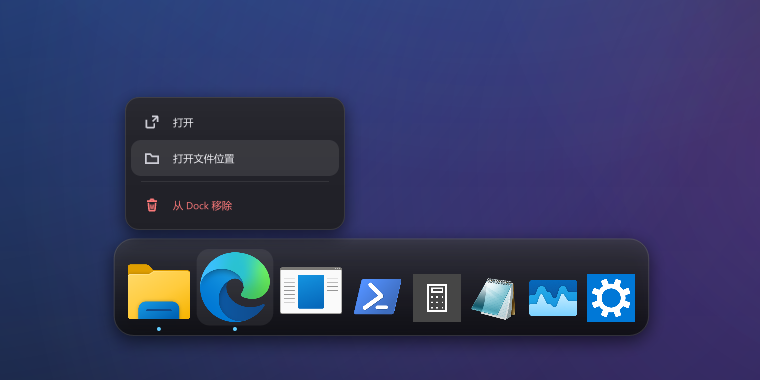
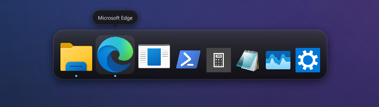

# Glide-Dock

> 一个更轻、更快、更贴近 Windows 11 的桌面 Dock。
> **你拖进去什么，它就有什么** —— 不扫描、不推断、不打扰。

> **文档版本 2.5 · 2026-11-14**
> 当前交付：**v0.4.0（M1 + M2 完成，M3 部分完成，M4 设置中心与五层动效系统已落地）**
> 代码、预览图与验收记录见仓库根目录、[`preview/`](../preview/) 与
> [PLAN.md](PLAN.md)。



---

## 这是什么

Glide-Dock 是一个常驻桌面的应用启动栏，用 Rust 与原生 Win32 实现。

它保留 Winstep Nexus 最有价值的效率能力（拖放管理、常驻启动、运行状态、外观可调），但
**重新设计**了内容来源、交互模型与视觉语言 —— 更接近 Windows 11 任务栏、macOS Dock 与
现代桌面启动器的融合，而不是传统 Windows 工具软件。

```
┌──────────────────────────────────────────────┐
│  拖入 .lnk / .exe / 文件夹 / 文件             │
│  → 解析目标 → 生成条目 → 保存 → 图标显示      │
│  → 点击启动 · 悬停放大 · 拖动排序 · 拖出移除  │
└──────────────────────────────────────────────┘
```

## 三个「不」

| 原则 | 含义 |
| --- | --- |
| **不扫描** | 启动时不枚举开始菜单、`Program Files`、注册表；首次启动是**空 Dock**，只有一行提示 |
| **不推断** | 进程监控只用来点亮图标下方的小圆点，绝不自动新增、隐藏或重排你的条目 |
| **不丢失** | 快捷方式失效、目标被卸载，条目依然在，图标显示占位符与警示角标，随时可修可删 |

大多数同类软件会在首次启动时往你的 Dock 里塞满它「认为你会用」的应用。Glide-Dock 不做这件事。

---

## 核心能力

| 能力 | 说明 | 状态 |
| --- | --- | --- |
| 拖入添加 | `.lnk` / `.exe` / 文件夹 / 文件；解析目标、参数、起始目录；按落点插入 | ✅ 已实现 |
| 点击启动 | `ShellExecuteW`；优先使用原始 `.lnk`，失败弹提示并保持条目 | ✅ 已实现 |
| 悬停动效 | 6 套预设：Glide Zoom / Bounce / Wave / Fluid Press / Glow / Perspective | ✅ 已实现 |
| 启动动效 | 4 套预设：Glide Launch / Triple Bounce / Ripple Launch / Pulse Launch | ✅ 已实现 |
| 动效合成 | Hover / Press / Launch / Status / Compose 独立通道，互不覆盖 | ✅ 已实现 |
| 拖动排序 | 越过 8 DIP 阈值进入拖拽，插入指示条，松手落盘 | ✅ 已实现 |
| 拖出移除 | 拖出 Dock 上边界松手即移除 | ✅ 已实现 |
| 右键菜单 | 打开 / 打开文件位置 / 从 Dock 移除 / 重载 / 配置目录 / 退出；不抢焦点 | ✅ 已实现 |
| 配置持久化 | JSON + 原子写 + 版本迁移 + 损坏自动备份 | ✅ 已实现 |
| 主题 | 深色 / 浅色 / 跟随系统，注册表读取系统偏好 | ✅ 已实现 |
| 毛玻璃背景 | Windows.UI.Composition HostBackdropBrush 实时模糊 + composition 圆角；不截屏，不可用时半透明渐变；可用 `appearance.frosted_glass` 关闭 | ✅ 已实现 |
| DPI / 工作区 | Per-Monitor V2，`rcWork` 避让任务栏，`WM_DPICHANGED` 重排 | ✅ 已实现 |
| 单实例 | 命名互斥体；第二次启动自动退出 | ✅ 已实现 |
| 运行状态 | 图标底部圆点；`SetWinEventHook` 事件驱动，启动/悬停/窗口事件时刷新 | ✅ 已实现 |
| 应用启动 | EXE `CreateProcessW`；LNK/文件/文件夹/URL `ShellExecuteExW`；商店应用 AAM；统一 LauncherService | ✅ 已实现 |
| 商店应用 | 右键“添加商店应用...”按需扫描 Start AppsFolder，AUMID 持久化与图标提取 | ✅ 已实现 |
| 小组件 | 内置开始菜单按钮（原生 Win 键）、视觉分隔线，可拖动排序 | ✅ 已实现 |
| Dock 层级 | 桌面同级 / 动态层级 / 始终置顶，设置中心可切换 | ✅ 已实现 |
| 自动隐藏 | 延迟隐藏、贴边唤出 | ⬜ 未接线 |
| 多显示器 | 记忆具体显示器、拔插回退 | 🟡 仅 `WM_DISPLAYCHANGE` 重排 |
| 开机启动 | 双模式：快速计划任务 / 兼容 HKCU Run，行为页可展开选择 | ✅ 已实现 |
| 系统托盘 | 品牌图标、设置/外观/Dock 层级/提示/退出；Explorer 重启自动恢复 | ✅ 已实现 |
| 守护进程 | 隐藏 `--guard` 进程，异常退出自动重启，正常退出不重启 | ✅ 已实现 |
| 权限诊断 | 检测管理员 / Low Integrity，提示 UIPI 拖放限制 | ✅ 已实现 |
| 全局热键 | `RegisterHotKey` | ⬜ 未实现 |
| 安装包 | Inno Setup 安装/卸载、开始菜单/桌面快捷方式、启动项清理 | ✅ 已实现 |
| 设置中心 | WinUI 3 卡片式设置、搜索、实时同步、动效预设/参数/复制配置；Dock 为唯一写者 | ✅ 已实现（独立进程） |
| 任务管理 | 点击运行中图标切换/最小化/恢复窗口 | ⬜ 计划 M5 |
| 桌面小组件 | 时钟、CPU、内存、回收站 | ⬜ 计划 M5 |

**明确不做**：应用商店、皮肤包、全盘扫描（仅按需扫描 Start AppsFolder）、多层属性对话框、内置 Web 引擎。

---

## 交互与视觉



| 参数 | 默认值 |
| --- | --- |
| Dock 高度 / 图标 / 间距 | 76 px / 48 px / 18 px（中心间距 66 px） |
| 内边距 / 圆角 | 14 px / 20 px |
| 背景 | 深色半透明（不透明度 0.78），1 px 高光描边，柔和外阴影 |
| 悬停放大 | Glide Zoom 连续场，峰值 1.35×（可调 1.05–3.50×），半径 1.7 × 中心间距（112.2 DIP），35/50ms |
| 动效 | Glide Zoom 连续场 35/50ms；其余悬停 5 套 / 启动 4 套，基准 180ms，弹性强度 75% |
| 位置 | 屏幕工作区底部居中；窗口底边距工作区 10 DIP，玻璃底边另留 24 DIP 阴影余量 |
| 主题 | 深色 / 浅色 / 跟随系统 |
| 提示 | 悬停约 0.42 s 后浮现在 Dock 上方 |

视觉语言：Windows 11 Fluent + 现代极简。半透明材质、柔和阴影、统一圆角、高清图标、
**细腻但有克制**的动效。禁止 Win7 风格、拟物材质、霓虹光效。

实现取舍：

- Dock 背景与图标一起轻微「呼吸」：悬停时背景向上/向两侧扩展，而不是固定矩形；
- 右键菜单与 Dock 共用同一个分层窗口，窗口顶部预留菜单与提示的空间；
- 透明区域通过 `WM_NCHITTEST → HTTRANSPARENT` 点击穿透，不打扰桌面。

---

## 技术栈（实际使用，2026-11-08）

| 层 | 选型 | 版本 |
| --- | --- | --- |
| 语言 | Rust（Edition 2024） | 1.99.1 stable-msvc |
| Windows 集成 | `windows`（Win32 / COM / Shell / GDI） | 0.62.2 |
| Dock 渲染 | 分层窗口 + `UpdateLayeredWindow` + `tiny-skia` | 0.12.0 |
| 文本光栅 | `ab_glyph`（Segoe UI + Microsoft YaHei 回退） | 0.3.32 |
| 配置 | `serde` + `serde_json` | 1.0.229 / 1.0.154 |
| 日志 | `tracing` + `tracing-subscriber` | 0.1.44 / 0.3.33 |
| 错误 | `thiserror` | 2.0.21 |
| 设置中心 | Windows App SDK / WinUI 3（C#，独立进程） | 1.7.260224002 |

> **关于 `windows-window` / `windows-composition`**：这两个 crate 存在于 0.100 家族，
> 但与主包 `windows 0.62.2` 使用不同的 `windows-core` 大版本，类型互不兼容。Glide-Dock
> 只锁一条版本线，渲染层用 trait 隔离开关，待上游对齐后再评估 Composition 后端。详见
> [ARCHITECTURE.md](ARCHITECTURE.md) §3.2。

---

## 项目结构（实际）

```
Glide-Dock/
├── app/                              # glide-dock.exe
│   └── src/
│       ├── main.rs                   # CLI、日志、DPI、单实例、消息循环
│       ├── app.rs                    # DockApp 状态机：输入 → 命令 → 状态 → 渲染
│       ├── wndproc.rs                # 窗口过程 + panic 兜底
│       ├── render_loop.rs            # 帧时钟
│       └── preview.rs                # 无窗口预览生成（真实图标）
├── crates/
│   ├── dock-core/                    # 纯领域模型 + 几何 + 布局 + 五层动效引擎
│   ├── dock-render/                  # tiny-skia：Dock / 菜单 / 提示 / 阴影 / 字体
│   ├── dock-storage/                 # 配置读写、原子写、迁移、损坏恢复
│   └── dock-platform-windows/        # 窗口、DIB、Shell、图标线程、拖放、DPI
├── preview/                          # 离线渲染的设计评审图
└── .agent/                           # 本文件、架构与计划
```

依赖方向严格单向：`app → {platform, render, storage} → core`。

---

## 路线图

| 里程碑 | 内容 | 验收标准 | 状态 |
| --- | --- | --- | --- |
| **M0 方案定稿** | 产品边界、架构、依赖核实、交互规范、任务分解 | 两份文档评审通过 | ✅ 已定稿 |
| **M1 首帧** | workspace、`dock-core`、分层窗口、渲染管线、空状态 | 底部出现半透明 Dock；透明区穿透；空闲 CPU 近 0 | ✅ 已实现 |
| **M2 MVP 闭环（v0.1）** | 拖入解析、图标缓存、点击启动、放大、排序、拖出移除、菜单、持久化 | 拖入 5 个应用重启仍在；点击启动；放大流畅；坏配置自愈 | ✅ 已实现 |
| **M3 桌面级体验** | 自动隐藏、多显示器、DPI、单实例、开机启动、热键、运行状态 | 双屏混合 DPI 位置正确；空闲内存 < 25 MB | 🟡 部分（DPI / 单实例 / 运行圆点） |
| **M4 设置中心** | WinUI 3 单窗口、主题/强调色/尺寸/行为/动画、搜索、恢复默认 | 任一设置改动即时预览并落盘 | ✅ 已实现（v0.1 提前） |
| **M5 任务管理 + 小组件** | 窗口分组与切换、最小化恢复、时钟/CPU/内存组件 | 点击运行中图标能切换窗口 | ⬜ 待开始 |
| **M6 渲染升级与发布** | DirectComposition 评估、ARM64、签名 | 40 图标全放大仍 60 FPS | ⬜ 待开始 |

详细任务拆分、验收门禁与交付记录见 [PLAN.md](PLAN.md)。

---

## 性能目标与实测说明

| 指标 | 目标 | 上限 |
| --- | --- | --- |
| 空闲 CPU | < 0.1% | 0.5% |
| 动画 CPU | < 3% | 8%（v0.3.3 实测；v0.4 动效未重新基准，留待目标机测量） |
| 内存（工作集） | < 25 MB | 40 MB |
| 冷启动到首帧 | < 300 ms | 600 ms |
| 单帧渲染（10 图标） | < 4 ms | 8 ms |

已实现的关键机制：

- 所有弹簧收敛后 `KillTimer`，消息循环阻塞在 `GetMessageW`；`--selftest` 会断言空闲时
  没有帧定时器；
- DIB 与内存 DC 在窗口生命周期内复用；
- 图标 256 px 母版只解码一次，按绘制尺寸双线性缩放；
- 图标抽取、`.lnk` 解析不阻塞 UI 线程。

**尚未完成**：在目标硬件上做 60 s 平均 CPU、工作集与帧时间的正式测量。字体加载会
占用约 20 MB（Microsoft YaHei 单份 + Segoe UI），因此 25 MB 工作集目标需要后续用
GDI/DirectWrite 文本或字体子集化重新评估。

---

## 快速开始

> Windows 10 1809+ 或 Windows 11（x64）；Rust 1.85+，MSVC 工具链，Windows SDK 10.0.19041+。
> 不需要 Node.js、WebView2 或任何运行时。

```powershell
cargo run -p glide-dock                    # 空白 Dock
cargo run -p glide-dock -- --demo          # 示例 Dock（preview/demo-config.json）
cargo run -p glide-dock -- --selftest      # 建窗、渲染、空闲断言，退出码 0
cargo run -p glide-dock -- --render-preview preview
cargo build --release -p glide-dock        # release 下隐藏控制台
```

配置文件位置：`%APPDATA%\Glide-Dock\config.json`；
日志：`%LOCALAPPDATA%\Glide-Dock\logs\glide-dock.log`。

> 若以管理员身份运行，Windows UIPI 会阻止来自普通资源管理器的拖放；请以普通用户运行。

---

## 常见问题

**Q：为什么不自动扫描已安装的应用？**
A：因为那会把「你的 Dock」变成「程序的清单」。Glide-Dock 的条目集合是用户意志的完整映射：
拖进去才有，删掉就没了。首次启动是空的，这是设计，不是缺陷。

**Q：设置在哪里？**
A：右键 Dock 背景 →「设置...」，或运行 `glide-dock.exe --settings`。设置中心使用
WinUI 3 原生控件，是独立进程；改动通过 `WM_COPYDATA` 实时同步给 Dock，由 Dock
300 ms 防抖后原子保存（设置进程不再整文件回写）。
窗口层级的约定：Dock 位于桌面层（非 topmost），设置中心是普通应用窗口。

**Q：运行圆点是怎么更新的？**
A：由 `SetWinEventHook` 事件驱动：启动时枚举一次可见顶层窗口，之后只在窗口创建/显示/
隐藏/销毁时合并刷新；不轮询进程，悬停时也不启动额外定时器。

**Q：支持 Windows 10 吗？**
A：支持 1809 及以上。分层窗口与 Shell 接口在 Win10 上完全可用；Windows 11 上视觉效果
更贴合系统。

**Q：点击 Dock 会不会把我正在用的窗口切走？**
A：不会。窗口带 `WS_EX_NOACTIVATE`，点击不激活 Dock、不抢焦点。

**Q：为什么不用 Tauri / Electron？**
A：Dock 只需要画十几个图标，却要常驻内存。Web 渲染进程意味着 80 MB+ 的常驻开销，而且
窗口层级、点击穿透、拖放、`NOACTIVATE` 这些关键能力都要绕一大圈。原生 Win32 + 小面积
光栅更合适。

**Q：内存能压到多少？**
A：当前主要开销是字体数据与图标母版；25 MB 的早期目标尚未达成，见「性能目标与实测说明」。

**Q：开源吗？**
A：Glide-Dock 源代码采用 MIT OR Apache-2.0。设置中心使用 Microsoft Windows App SDK /
WinUI 3，该运行时受 Microsoft 软件许可约束，分发自包含设置目录时请保留其
`WindowsAppSDK-license.txt`。项目不再使用 Slint。

---

## 文档

- [架构设计](ARCHITECTURE.md) —— 分层、数据模型、渲染与动画数学、平台细节、实现记录
- [实施计划](PLAN.md) —— M1–M6 任务卡、门禁清单、验收记录
- [根目录 README](../README.md) —— 仓库首页、快速开始
- [预览图画廊](../preview/README.md) —— 评审用截图与重新生成方式

## 许可证

MIT OR Apache-2.0。
