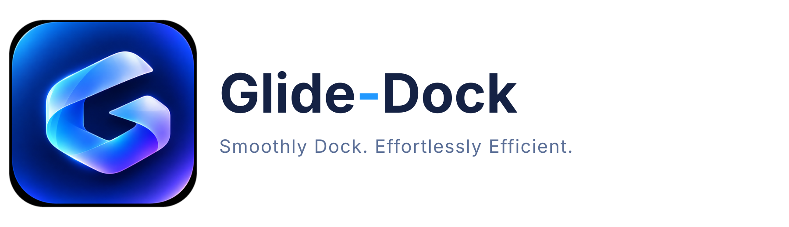
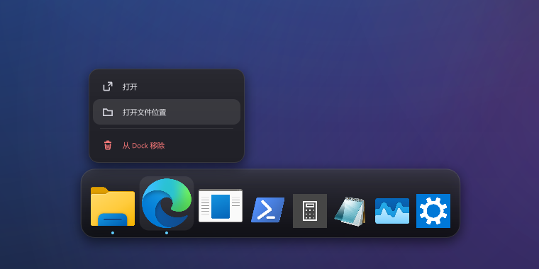
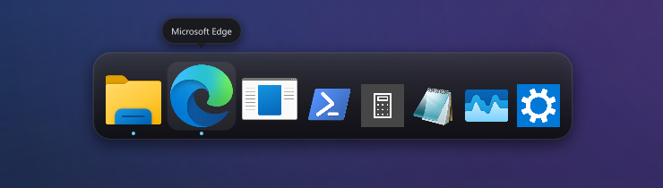
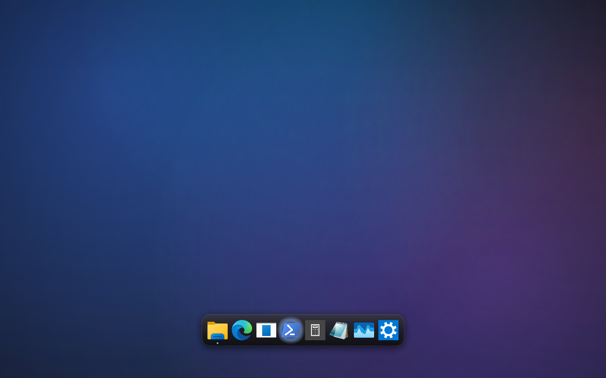
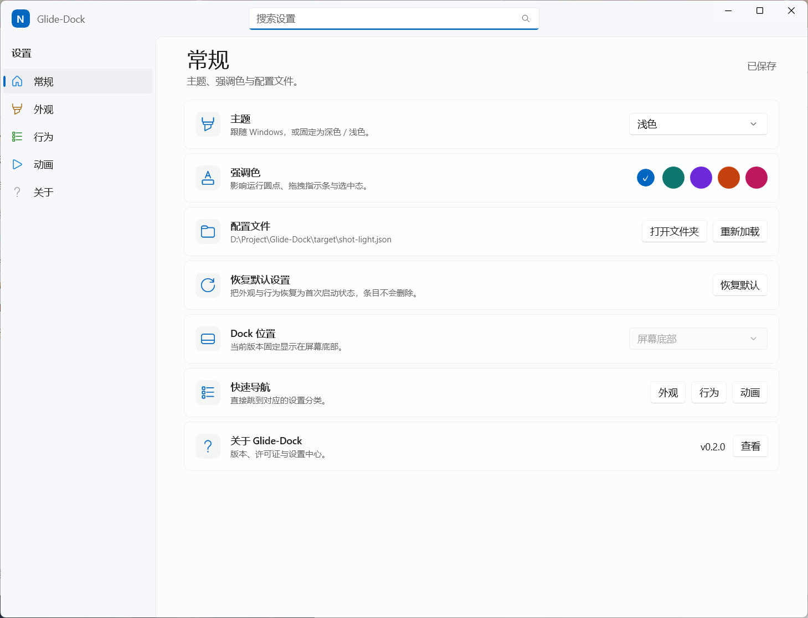
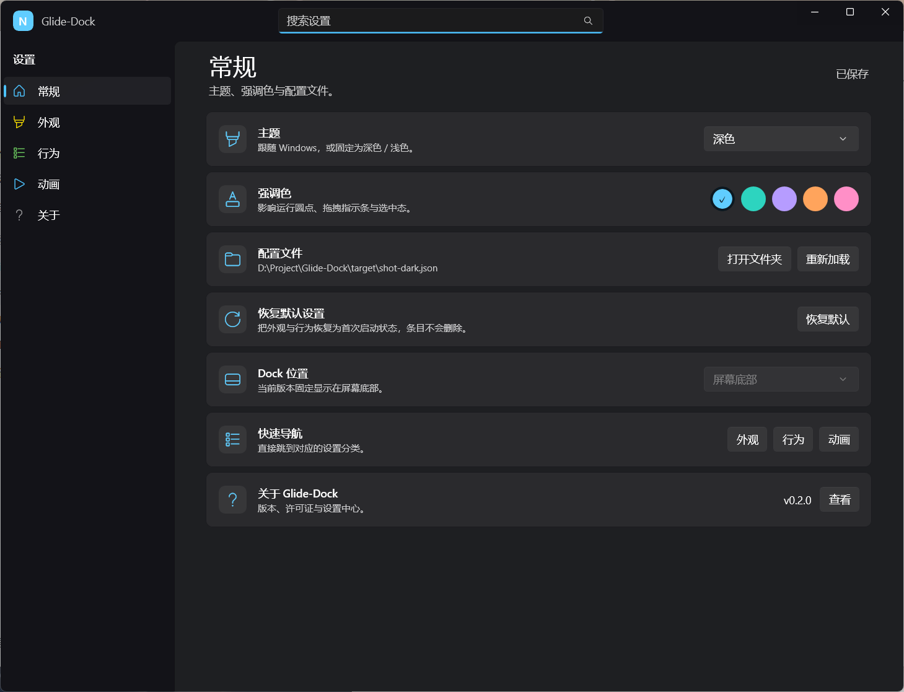

# Glide-Dock

> 一个更轻、更快、更贴近 Windows 11 的桌面 Dock。
> **你拖进去什么，它就有什么** —— 不扫描、不推断、不打扰。

Glide-Dock 是一个用 **Rust + Win32** 实现的常驻桌面启动栏：首次启动是空的，拖入
`.lnk` / `.exe` / 文件夹 / 文件后才生成条目。它保留 Winstep Nexus 的效率内核
（常驻、拖放管理、运行状态、外观可调），但重新设计了内容来源、交互与视觉语言。













## 当前状态

**v0.4.3 · M2 MVP 已完成，M3 部分完成，M4 设置中心与五层动效系统已落地。**

| 能力 | 状态 |
| --- | --- |
| 拖入 `.lnk` / `.exe` / 文件夹 / 文件并解析 | ✅ 已实现 |
| 快捷方式目标、参数、起始目录解析，优先直接启动 EXE | ✅ 已实现 |
| 文件 / 文件夹 / URL 走 `ShellExecuteExW`，商店应用走 AAM | ✅ 已实现 |
| 商店 / MSIX 应用扫描（Start AppsFolder）与右键添加 | ✅ 已实现 |
| 内置小组件（开始菜单）、视觉分隔线、右键添加 | ✅ 已实现 |
| Dock 层级：桌面同级 / 动态层级 / 始终置顶 | ✅ 已实现 |
| Shell 图标提取（256 px 母版、预乘归一化；支持 AppsFolder） | ✅ 已实现 |
| 异步启动 / 失败提示 | ✅ 已实现 |
| 六套悬停动效（Glide Zoom / Bounce / Wave / Fluid Press / Glow / Perspective） | ✅ 已实现 |
| 四套启动动效（Glide Launch / Triple Bounce / Ripple Launch / Pulse Launch） | ✅ 已实现 |
| Fluid Press 按压、Bounce/Glow 点击彩蛋、启动邻位避让 | ✅ 已实现 |
| Hover / Interaction / Launch / Status / Composition 五层独立合成 | ✅ 已实现 |
| 启动等待呼吸点 / 运行状态点（4 DIP） | ✅ 已实现 |
| 设置中心切换动效、调参、实时同步、复制动画配置 | ✅ 已实现 |
| 动画关闭 / 跟随系统减少动态效果 / 刷新率与 DPI 适配 | ✅ 已实现 |
| 主 Dock 硬件绘制 | ✅ 默认尝试 D3D11 + Direct2D，故障时自动回退 tiny-skia |
| 拖动排序 / 拖出移除 | ✅ 已实现 |
| 右键菜单（设置、添加开始菜单/分隔线/商店应用、打开、打开位置、移除、重载、配置目录、退出） | ✅ 已实现 |
| JSON 配置、原子写、版本迁移、损坏自愈 | ✅ 已实现，schema v3 |
| 毛玻璃背景（Windows.UI.Composition 实时 HostBackdropBrush） | ✅ 已实现，不截屏；失败时使用主题半透明渐变；可用 `appearance.frosted_glass` 关闭 |
| 深色 / 浅色 / 跟随系统主题 | ✅ 已实现 |
| 五种强调色 | ✅ 已实现 |
| 设置中心（主题/尺寸/材质/行为/动画/恢复默认） | ✅ 已实现 |
| 实时预览：设置改动即时通知 Dock | ✅ 已实现 |
| Per-Monitor V2 DPI、任务栏工作区避让 | ✅ 已实现 |
| 单实例运行 | ✅ 已实现 |
| WindowTracker 事件驱动运行状态 | ✅ 已实现，不再轮询进程 |
| 系统托盘（设置 / 外观 / Dock 层级 / 退出） | ✅ 已实现 |
| 守护进程：异常退出自动重启，正常退出不重启 | ✅ 已实现 |
| 权限诊断：管理员 / Low Integrity / 拖放状态 | ✅ 已实现，位于设置中心诊断页 |
| 设置中心「诊断与维护」页：拖拽、UAC、守护、启动、快捷方式 | ✅ 已实现 |
| 自动隐藏 / 全局热键 | ⬜ 未实现 |
| 开机自启动（计划任务 / HKCU Run 双模式） | ✅ 已实现 |
| 应用安装包（Rust + Tauri 安装器与卸载器） | ✅ 已实现 |
| 多显示器切换记忆 | 🟡 依赖 `WM_DISPLAYCHANGE` 重排，未完整记忆 |
| 任务切换 / 时钟/CPU 数据小组件 | ⬜ 计划 M5 |

设计文档中的三条约束仍然成立：

- **不自动扫描**：启动时不枚举开始菜单、`Program Files` 或注册表；只有用户主动选择
  “添加商店应用”时才扫描 Start 的 AppsFolder；
- **不推断**：运行状态只点亮图标下方的小圆点，不自动新增/隐藏/重排；
- **不丢失**：目标失效的条目保留在 Dock 中，显示占位图标与警示角标。

## 快速开始

**环境**

- Windows 10 1809+ / Windows 11（x64）
- Rust stable（MSVC 工具链）
- 运行安装器需要 Microsoft Edge WebView2 Runtime；Dock/Slint 本身不需要 .NET
- Windows SDK 10.0.19041+
- 设置中心由 Dock 内置的 Rust + Slint UI 提供，不需要单独安装或启动设置程序

> **完整性标签警告**：如果仓库位于沙箱工作区，根目录可能带有
> `Mandatory Label\Low`。在该目录里构建/复制出的 `target\release\glide-dock.exe`
> 会继承 Low 标签，Windows 会以 **Low Integrity** 启动 Dock，子应用也会是 Low，
> 导致 JetBrains AF_UNIX bind、AppData 写入等失败，很多应用启动后立即退出。
> **不要直接运行工作区里的 exe**；用下面的 `scripts/package.ps1` 生成普通目录中的
> Medium 完整性包，或把 zip 解压到桌面再运行。

```powershell
# 推荐：构建并打包到 %LOCALAPPDATA%\Glide-Dock\Glide-Dock-v0.4.3（Medium 完整性）
powershell -ExecutionPolicy Bypass -File scripts/package.ps1

# 构建品牌安装包（单文件 Setup.exe；输出到 %LOCALAPPDATA%\Glide-Dock\installer）
powershell -ExecutionPolicy Bypass -File scripts/build-installer.ps1

# 空白 Dock（仅适合从普通目录运行）
cargo run -p glide-dock

# 带内置示例条目的演示模式（写到 preview/demo-config.json，不污染真实配置）
cargo run -p glide-dock -- --demo

# 打开 Dock 内置的设置中心
cargo run -p glide-dock -- --settings

# 无窗口自检：建窗 → 渲染一帧 → 断言全部定时器空闲 → 不读写用户配置 → 退出码 0
cargo run -p glide-dock -- --selftest

# 强制使用 CPU，可用于故障排查或性能对照
$env:GLIDE_DOCK_RENDERER = 'cpu'
cargo run -p glide-dock -- --selftest
Remove-Item Env:GLIDE_DOCK_RENDERER

# 生成预览图到 preview/（使用真实系统图标）
cargo run -p glide-dock -- --render-preview preview

# 发布构建（release 下不显示控制台窗口）
cargo build --release -p glide-dock
```

安装到开始菜单的只有 **Glide-Dock** 一个 Dock 快捷方式；设置从 Dock 右键 →
**设置...** 打开，不注册独立的“Glide-Dock 设置”快捷方式。

配置文件：`%APPDATA%\Glide-Dock\config.json`
日志：`%LOCALAPPDATA%\Glide-Dock\logs\glide-dock.log`

调试时可指定独立配置文件：

```powershell
cargo run -p glide-dock -- --config .\preview\my-config.json
```

发布时使用 `scripts\\build-installer.ps1` 生成的 Tauri 安装器；安装器会把 Rust Dock及其资源解包到目标目录。Dock/Slint 分发不再要求 .NET SDK、WinUI 发布目录或 `settings-app\\publish`。

安装与更新由下载的新版安装 EXE 执行；权限足够时直接在当前进程的后台线程完成，只有需要 UAC 时才提权启动同一文件交接操作。只有版本更高的安装包允许更新；同版、旧版或无法识别已安装版本时均禁止覆盖。安装目录仅保留独立的 `Glide-Dock 卸载程序.exe`，不包含旧安装包数据，也不提供更新入口；卸载时仅在需要删除自身所在目录的情况下复制到临时目录。构建脚本会先生成 `glide-uninstall`，再将它与应用数据嵌入单文件安装包。卸载进程的工作目录始终位于安装目录之外，部分删除后仍可依据注册信息继续清理；程序文件已经移除时，残留空目录、快捷方式、卸载记录或个人数据的清理问题会显示为完成后的警告，仍有程序文件未删除时则保留卸载记录并允许重试。

安装与卸载窗口采用固定尺寸，常规为 840×620 逻辑像素，小屏幕或高 DPI 下会在启动时适配工作区；窗口仅保留关闭按钮，禁止手动缩放、最大化和最小化。窗口外框为直角矩形，浅色、深色均使用渐变细描边、内侧高光与系统阴影，关闭按钮采用灰色细线叉号。

## 交互

| 操作 | 行为 |
| --- | --- |
| 悬停图标 | 以光标为中心的衰减放大，邻近图标联动位移 |
| 悬停约 0.4 s | 图标上方出现名称气泡 |
| 左键点击 | 普通 EXE 直接 `CreateProcessW`；快捷方式/文件/文件夹/URL 走 Shell；商店应用走 AAM；失败弹红色提示并保持原状 |
| 按住拖动 > 8 DIP | 进入排序，显示插入指示条，松手落盘 |
| 拖到 Dock 上方 24 DIP 以外松手 | 移除条目，带收缩动画 |
| 右键图标 | 打开 / 打开文件位置 / 从 Dock 移除 |
| 右键 Dock 背景 | 设置... / 添加开始菜单 / 添加分隔线 / 添加商店应用... / 退出 |
| 从资源管理器拖入 | 按落点插入，自动解析快捷方式并提取图标 |
| 点击 Dock 外 | 点击穿透到桌面；菜单打开时点击外部会关闭 |

窗口带 `WS_EX_NOACTIVATE`：点击 Dock 不会抢走当前窗口焦点。Dock 不再是
`WS_EX_TOPMOST`：它位于桌面层，普通应用窗口可以覆盖它；设置中心是普通应用窗口，
可正常获得焦点、出现在任务栏，并显示在 Dock 之上。

### 应用启动

所有启动请求统一进入后台 `LauncherService`，不经过 `cmd.exe` 或 PowerShell：

| 类型 | 实现 |
| --- | --- |
| EXE | `CreateProcessW` + 标准用户环境块 |
| LNK | 添加时用 `IShellLinkW` 解析目标、参数、起始目录；目标为 EXE 时优先直接启动 EXE |
| 文件 / 文件夹 / URL | `ShellExecuteExW` |
| 商店 / MSIX | `IApplicationActivationManager.ActivateApplication(AUMID)` |

`.lnk` 解析后的 `launch_type` 与 AUMID 持久化在 `DockItem` 中；Low Integrity 进程无法
创建 AAM 时自动回退到 `shell:AppsFolder\{AUMID}`。右键“添加商店应用...”会异步扫描
Start 的 AppsFolder，只列出带 AUMID 的打包应用，选择后写入 Dock。


### 小组件与分隔线

右键 Dock 背景可直接添加：

- **开始菜单**：按系统 build 选择用户提供的 icons8 Windows 10/11 彩色标志
  （Windows 11 `#1976D2` 四格 / Windows 10 `#00B0FF` 斜切四格），无白色底板；
  点击用原生 Win 键和弦打开 Windows 开始菜单，不经过
  `cmd.exe` / PowerShell；
- **分隔线**：保留原来的 12 DIP 槽宽和两侧 18 DIP 间距，但只有 1.5px 竖线；
  不绘制 hover 背景、不显示 tooltip、不参与悬停放大、按压或启动动画；
  可拖动排序；右键只提供移除；
- **添加商店应用...**：后台扫描 AppsFolder 后选择。

### 双平台版本发布

版本发布到 [GitHub Releases](https://github.com/won114514/Glide-Dock/releases) 和
[CNB Releases](https://cnb.cool/won114514/Glide-Dock/-/releases)。两端使用同一次 Windows 构建生成的安装包与 SHA-256 校验文件。

推送与 `Cargo.toml` 版本一致的 `v*` 标签后，CI 先运行 Rust、安装界面和发布脚本检查，再构建发布产物。
GitHub 发布安装包后，同步主分支与版本标签到 CNB。CNB 原生流水线使用平台临时令牌，核验并上传同一份安装包和校验文件到正式 Release 页面。
配置、权限和失败重试见 [双平台发布说明](docs/RELEASING.md)。

### Dock 层级

设置 → 常规 → **Dock 层级**：

| 选项 | 行为 |
| --- | --- |
| 桌面同级 | 位于壁纸之上、普通应用窗口之下（原行为） |
| 动态层级 | 平时在桌面层，鼠标悬停/菜单/拖动时自动置顶，离开后落回 |
| 置顶 | 始终位于普通窗口之上 |

配置字段为 `appearance.layer`（`desktop` / `dynamic` / `topmost`）；默认保持
`desktop`。动态/置顶切换使用 `WS_EX_TOPMOST` + `SetWindowPos`，不会抢焦点。

### 开机自启动

设置 → 常规 → **开机自启动**。卡片右侧是开关，展开卡片后选择启动方式：

| 模式 | 机制 | 权限 | 特点 |
| --- | --- | --- | --- |
| 快速 | 当前用户登录触发的计划任务，无延迟，优先级 4 | 首次/删除需要管理员授权 | 登录后更早出现 |
| 兼容 | `HKCU\Software\Microsoft\Windows\CurrentVersion\Run` 值 `Glide-Dock` | 无需管理员 | Windows 11 可能主动延迟 |

- 两种模式互斥；切换时先启用新模式，再清理旧模式；
- 关闭开关会清理两种机制；
- 模式偏好保存在 `%APPDATA%\Glide-Dock\startup-mode.txt`，不写入 config.json；
- 计划任务动作带 `--autostart`，Dock 会短暂等待 `Progman` 桌面就绪；
- UAC 取消时开关回退，不会留下半注册状态。

### 系统托盘与守护进程

Dock 运行时显示品牌托盘图标，右键菜单由 Dock 自己绘制（不是系统原生菜单）：

- 圆角浮动卡片、线框图标、子菜单箭头；
- 左键：打开设置；
- 右键：打开设置、外观 >、Dock 层级 >、退出；
- 不含权限诊断、重新加载配置或配置目录入口；
- 点击菜单外、点击任务栏或按 Esc 会关闭；
- Explorer 重启后自动重新注册托盘图标。

Dock 同时启动一个隐藏的 `glide-dock.exe --guard` 守护进程：

- Dock 异常退出（崩溃、任务管理器结束）后 1 秒重启；
- 正常退出（托盘“退出”、Alt+F4）退出码为 0，守护进程不重启；
- 60 秒内最多重启 5 次，防止崩溃循环；
- 安装包卸载时现有 `taskkill /IM glide-dock.exe` 会同时结束守护进程。

### 设置界面与安装器

当前设置入口为 Dock 进程内的 Rust + Slint 窗口，UI 位于 `app/ui/settings.slint`。
侧栏选中态由当前页面统一决定，重复点击与来回切换不会留下旧页面的高亮。
卡片按可用宽度调整布局，说明文字自动换行，滑块显示实时数值；
设置窗口支持浅色、深色和跟随系统，并根据所在显示器工作区与 DPI 设置初始大小。

安装器由 `installer` 目录下的 Rust + Tauri 与 Fluent UI React v9 实现，采用官方控件和 SVG 图标。
左侧步骤导航、右侧设置内容与底部操作区分开布局，首次设置采用整行偏好设置和可展开的应用列表。窄窗口会收起步骤说明，
内容独立滚动，底部操作区保持可见。分发包包含设置中心的内置中文字体及许可证。
实现梳理、问题原因与验证记录见 [设置中心与安装器检查记录](docs/SETTINGS-INSTALLER-REVIEW.md)。

### 设置中心「诊断与维护」

设置 → **诊断与维护** 可以查看：

- 版本、Dock 进程 ID、内存工作集与运行权限；
- Explorer 进程 ID、守护进程和 UAC 开关状态；
- 开机启动方式、开始菜单快捷方式与兼容性标记；
- 程序路径、配置文件和日志目录。

支持**刷新诊断**、**复制诊断**、**打开配置目录**和**打开日志目录**。
设置窗口与 Dock 在同一进程中运行，关闭设置窗口后 Dock 继续运行。

说明：管理员权限会触发 Windows UIPI，普通 Explorer 无法把文件拖进管理员进程；Low Integrity 也会限制拖放和子应用启动。

### 苹果式连续放大

`Glide Zoom` 不是每个图标自己的 Hover 动画，而是一个由 `dock-core::magnification`
统一维护的连续场：

- 固定基础中心 `aᵢ`、单一鼠标 `x`，`d=|x-aᵢ|`，`weight=smoothstep(1-d/R)`；
- `target=1+(Smax-1)·weight`；默认 `Smax=1.35`，`R=1.7×66=112.2 DIP`；
- 整场使用真实时间指数平滑，进入 `τ=35ms`、退出 `τ=50ms`，无过冲、无硬切；
- 图标采用 bottom-center 缩放，底部基准线固定。默认 1.35× 使用原槽位中心。
  碰到挤压时，在固定分隔线之间连续重排，优先使用间隙，空间不足时等比例缩减放大增量；
- 鼠标离开后目标归 1，但当前值按 50ms 平滑收敛；恢复中重新进入直接续接当前状态。

实现位置：`crates/dock-core/src/magnification/`。其他悬停预设仍保留各自的指针语言，
但默认的 Glide Zoom 走这条连续场。

## 视觉与默认参数

| 参数 | 默认值 |
| --- | --- |
| Dock 高度 / 图标 / 间距 | 76 px / 48 px / 18 px（中心间距 66 px） |
| 内边距 / 圆角 | 14 px / 20 px |
| 背景 | Windows.UI.Composition HostBackdropBrush 实时模糊；圆角 composition clip；不可用时半透明渐变 |
| 毛玻璃参数 | HostBackdropBrush 的 DWM 模糊；深色 tint 112 / 浅色 123，背景不透明度整体缩放 root opacity |
| 悬停放大 | Glide Zoom 连续场：峰值 1.35×（可调 1.05–3.50×），影响半径 1.7 × 中心间距 |
| 动效 | Glide Zoom 为全 Dock 连续鼠标场（35ms 进入 / 50ms 退出）；其他悬停：Bounce / Wave / Fluid Press / Glow / Perspective；启动 4 套 |
| 时长 / 弹性 | Glide Zoom 固定 35/50 ms；其他悬停基准 180 ms（进入 180 / 退出 140），弹性强度 75% |
| 位置 | 屏幕工作区底部居中；窗口底边距工作区 10 DIP，玻璃底边另留 24 DIP 阴影余量（原生玻璃不画外阴影） |
| 主题 | 深色 / 浅色 / 跟随系统 |

材质与动效刻意保持克制：墨色玻璃、圆角裁切、柔光悬停底、运行圆点；
没有霓虹、拟物皮肤和多余弹窗。

## 技术结构

```
app/                              # glide-dock.exe：CLI、消息循环、状态机、离线预览
installer/                        # Rust + Tauri + Fluent UI React 安装器（glide-setup.exe）
uninstaller/                      # 独立卸载程序（glide-uninstall.exe），复用安装器界面与卸载逻辑
crates/dock-core/                 # 纯模型 / 几何 / 布局 / 五层动效引擎 / 主题（零 OS 依赖）
app/src/presenter/                # D3D11 / Direct2D / DirectComposition、输入掩码与运行中回退
crates/dock-render/               # 共享 DockFrame、tiny-skia、文字与菜单位图
crates/dock-storage/              # JSON、原子写、迁移、损坏备份
crates/dock-platform-windows/     # 分层窗口、DIB、Shell、图标线程、拖放、DPI
preview/                          # 离线渲染的设计评审图 + 设置中心截图
scripts/build-installer.ps1       # 构建 payload 并编译 Tauri 安装器
```

依赖方向：`app → {platform, render, storage} → core`。设置中心由 Dock 进程内的 Rust + Slint
窗口承载，与主程序共享配置模型和状态，不需要 .NET 或独立设置进程。设置 UI 在专用窗口线程运行，
变更通过进程内命令队列交给 Dock 主线程校验、应用并落盘；Dock 仍是配置的唯一写者。核心逻辑
可在没有桌面的环境里跑单元测试；渲染器可以离线输出 PNG。

关键实现细节：

- **五层动效**：`dock-core::motion` 中的 Hover / Press / Launch / Status / Compose
  各自持有独立属性，统一输出 `MotionSnapshot`；缩放相乘、位移相加、光环按优先级取最强，
  悬停不会取消或覆盖启动时间轴。
- **LauncherService 解耦**：`app::launcher` 只负责后台启动与结果队列；动画引擎只接收
  `begin_launch` / `window_detected` / `window_closed` 等语义事件，从不等待启动结果。
  启动动画结束不代表应用已启动，等待状态仍只由 WindowTracker 控制。
- 主 Dock 默认由 D3D11 + Direct2D 绘制，DirectComposition 将预乘 BGRA 交换链呈现在原有分层窗口上。
  同一 HWND 承载右键菜单。GPU 模式按命中几何更新输入掩码，零 Alpha 区域允许下方应用收到点击。
  GPU 故障时由 tiny-skia 在原窗口绘制当前帧，离线预览也使用 tiny-skia。
- **字体**：Segoe UI + Microsoft YaHei 回退，`FontArc` 共享一份 19 MB CJK 字体，
  避免常规/半粗两份重复加载。
- **毛玻璃背景**：`Windows.UI.Composition` 的 `CreateHostBackdropBrush` + `DWMWA_USE_HOSTBACKDROPBRUSH`
  直接采样/模糊桌面，`CompositionRoundedRectangleGeometry` 裁出 20 DIP 圆角；
  全程 GPU、无第二个进程、不截屏。Composition 不可用时回退到主题半透明渐变。
- **图标线程**：`IShellItemImageFactory` 在独立 STA 线程执行，`GetDIBits` 时
  使用屏幕 DC（Shell 有时返回 DDB），检测 `rgb > a` 后统一预乘，规避黑边。
- **快捷方式解析**：`.lnk` 在独立的 STA resolver 线程解析目标、参数、起始目录；
  解析后通常直接以 `CreateProcessW` 启动目标 EXE，不再绕回快捷方式。网络路径或
  损坏快捷方式不会冻结 Dock。
- **商店应用**：`StoreAppService` 按需枚举 Start 的 AppsFolder，只保留 AUMID；
  右键“添加商店应用...”用原生菜单选择，图标从 `shell:AppsFolder\{AUMID}` 提取。
- **桌面层级**：Dock 使用 `WS_EX_NOACTIVATE | WS_EX_TOOLWINDOW | WS_EX_LAYERED`，
  默认不带 `WS_EX_TOPMOST`；显示时尝试插入到桌面之上、普通窗口之下。设置中的
  `desktop` / `dynamic` / `topmost` 分别对应桌面同级、交互时置顶、始终置顶。
- **设置窗口**：设置 UI 使用 Rust + Slint，作为 Dock 进程内窗口运行；窗口线程通过
  命令队列把变更交给 Dock 主线程。**Dock 是 `config.json` 的唯一写者**，并负责校验、
  即时应用和落盘，不会覆盖设置窗口打开期间新增或删除的条目。
- **启动**：普通 `.exe` 使用 `CreateProcessW` + `CreateEnvironmentBlock`（标准用户环境）
  和解析出的工作目录；`.lnk` 已解析为 EXE 时直接启动，否则交给 ShellExecuteEx；文件、
  文件夹和 URL 走 ShellExecuteEx；商店应用走 `IApplicationActivationManager`，Low
  Integrity 下回退到 AppsFolder。所有请求统一进入后台 LauncherService，不经过
  `cmd.exe` / PowerShell。
- 界面线程按显示器刷新率调度，每帧共用一个 `MotionSnapshot`。高精度可等待定时器不可用时使用
  `WM_TIMER`。动效完成后提交最终静止帧并停表，消息循环回到 `GetMessageW`。
  启动等待最多 12 s，菜单在 30 s 后或前台窗口变化时关闭。

## 验证

```powershell
cargo fmt --all -- --check
cargo clippy --workspace --all-targets -- -D warnings
cargo test --workspace
cargo run -p glide-dock -- --selftest
cargo run -p glide-dock -- --render-preview preview
```

当前结果：

- `cargo fmt` 通过；
- `cargo clippy -D warnings` 通过；
- Dock 相关的 195 项 Rust 单元测试通过（core 115 / render 23 / platform 25 / storage 13 / app 19）；
- `--selftest` 退出码 0，断言全部定时器与菜单均空闲，并且不读写用户配置；
- 动效引擎测试覆盖 6 套悬停、4 套启动、100/210/340ms、100/230/350/520ms、Wave 延迟、
  Perspective ±5°、组合倍率/位移、减少动态效果、60/120/144 Hz 与 v1/v2→v3 迁移；
- 商店应用扫描读取 Start 的 AppsFolder（当前机器 33 个），AUMID 图标提取、LNK 解析为
  EXE 启动、ApplicationActivationManager 创建与 Calculator 激活已在 Medium 完整性测试进程验证；
- 已用 `--render-preview` 生成 15–24 号动效图（6 套悬停 + 4 套启动），确认光晕、
  光环、倾斜与位移实际落像素；
- 已在 125% 缩放、2560×1440 工作区上手工验证窗口透明、悬停放大、提示、菜单、
  启动、拖动排序、拖出移除、菜单移除、退出与配置落盘；
- 启动请求由 LauncherService 后台线程执行，ShellExecute 慢时动画不受阻塞；
- Rust + Tauri `glide-setup.exe` 构建链路已迁移；安装器 UI 需要 Microsoft Edge WebView2 Runtime；
  Dock/Slint 运行与分发不需要 .NET；动效预设、参数与复制按钮需在可交互桌面环境点检；
- 设置窗口可拖动整个标题栏空余区域，位置写入配置旁的 `settings-window.txt`，
  重新打开不会回到居中；已实测拖动后保存/恢复为同一物理位置；
- 设置/启动修复：`.exe` 改走 `CreateProcessW` + 标准用户环境块；`.lnk` 不再重复
  传参；Explorer/Chrome 等从 Dock 启动不再出现空配置或初始化失败；
  已验证父进程 `%APPDATA%` 被指向工作区时，子进程仍收到
  `C:\Users\...\AppData\Roaming`；
- Dock 与设置窗口均不带 `WS_EX_TOPMOST`（已用 `GetWindowLongPtr` 验证）；
- 8 个系统应用的图标提取全部成功。

详细动效分层、时间轴、合成优先级与验证说明：[docs/ANIMATION.md](docs/ANIMATION.md)。

## 已知限制

- 自动隐藏与全局热键尚未接线（Dock 已支持双模式开机自启动）。
- 多显示器切换只会在 `WM_DISPLAYCHANGE` 时重新排布，未记忆具体显示器。
- Tauri 安装器依赖目标机的 Microsoft Edge WebView2 Runtime；未安装时安装向导无法显示。
- Dock/Slint 分发为 .NET-free；仓库中的 `settings-app` 与 `setup-app` 源码保留，但不参与当前安装器构建。
- UWP/Store 应用请通过开始菜单快捷方式（`.lnk`）加入；直接加入其 WindowsApps
  `.exe` 可能无法激活包身份。
- 运行状态由 `SetWinEventHook` 窗口事件驱动；启动等待由可见窗口确认或 12 s 超时
  结束，不通过动画结束或进程存在判断。
- 拖动排序使用插入指示条 + 浮动图标；其余图标的「让位」动画尚未实现。
- Perspective 用 2D 仿射近似 ±5° 倾斜，不做真 3D 投影；在 Dock 尺寸下视觉等价。
- 原生毛玻璃依赖 Windows 11 的 HostBackdropBrush / DWM composition；不支持的
  系统回退到半透明渐变，不会截屏。
- 原生毛玻璃的 Dock 背景固定在基础矩形，悬停时图标可以放大到玻璃之外。
- 图标缓存只在内存中，重启后重新提取；容量为 `max(64, 条目数)`，重载时清空。
  大字体数据使工作集高于 README 早期目标。
- UI 文案目前以中文为主，尚未提供多语言切换。
- 安装包未做代码签名；SmartScreen 可能拦截未签名构建。

## 文档

- [产品说明与路线图](.agent/README.md)
- [架构设计](.agent/ARCHITECTURE.md)
- [实施计划与验收记录](.agent/PLAN.md)
- [应用启动与商店应用扫描](docs/LAUNCHER.md)
- [动效系统](docs/ANIMATION.md)
- [预览图画廊](preview/README.md)

## 许可证

Glide-Dock 源代码：MIT OR Apache-2.0，见 [LICENSE-MIT](LICENSE-MIT) 与
[LICENSE-APACHE](LICENSE-APACHE)。

安装器使用 Rust + Tauri，并依赖目标系统提供 Microsoft Edge WebView2 Runtime。Dock及其 Slint UI 不依赖 .NET；仓库中的 `settings-app` / `setup-app` 目录保留现有源代码，但不属于本安装器的构建与分发步骤。

> Glide-Dock 保留 Winstep Nexus 的效率理念，但与 Winstep 无关联，也未使用其代码或皮肤资源。
